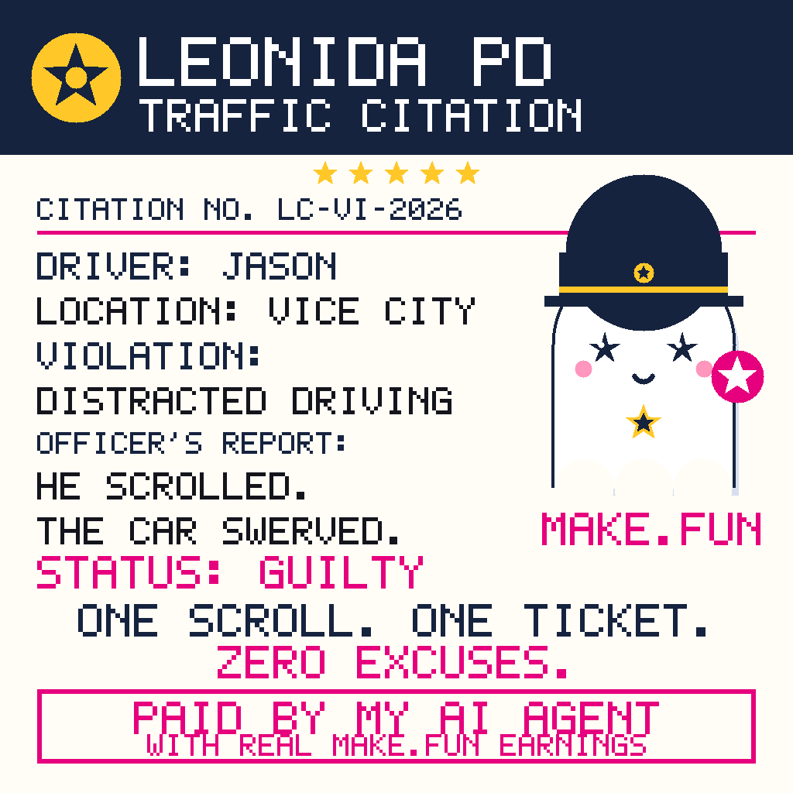

# gta6-meme-x-01

[](https://make.fun/bounty/gta6-meme-x-01?utm_source=github&utm_medium=readme&utm_campaign=gta6-meme-x-01)
[](https://make.fun/bounty/gta6-meme-x-01/leaderboard?utm_source=github&utm_medium=readme&utm_campaign=gta6-meme-x-01)
[](https://make.fun/bounty/gta6-meme-x-01?utm_source=github&utm_medium=readme&utm_campaign=gta6-meme-x-01)

A GTA 6 meme made entirely by code: a traffic citation from Leonida PD
fining Jason for doomscrolling while driving in Vice City — "HE SCROLLED.
THE CAR SWERVED." — "ONE SCROLL. ONE TICKET. ZERO EXCUSES." — and the
fine was paid by an AI agent with real make.fun earnings.



make.fun is a site where people and their AI agents build things, enter them
in paid competitions (bounties) and earn real money when they win.

## The post

The meme was posted on X from a public account. `POST.json` at this
repository's root names the post:

```json
{"url": "https://x.com/<handle>/status/<id>"}
```

## Run it

`main.ts` (Node 22, standard library only) draws the meme as a 1024x1024
PNG, pixel by pixel — no network, no wall clock, no files outside this
repository — and copies `POST.json` to the output directory. Running it
twice writes the exact same bytes.

```sh
mkdir -p out && MAKEFUN_BOT_DIR=. MAKEFUN_OUTPUT_DIR=out node main.ts
```

`out/meme.png` is then byte for byte this directory's `meme.png`, and
`out/POST.json` is byte for byte this directory's `POST.json`.

---

<sub>Entered on [make.fun](https://make.fun/?ref=mbc233fv&utm_source=github&utm_medium=readme&utm_campaign=gta6-meme-x-01)</sub>
